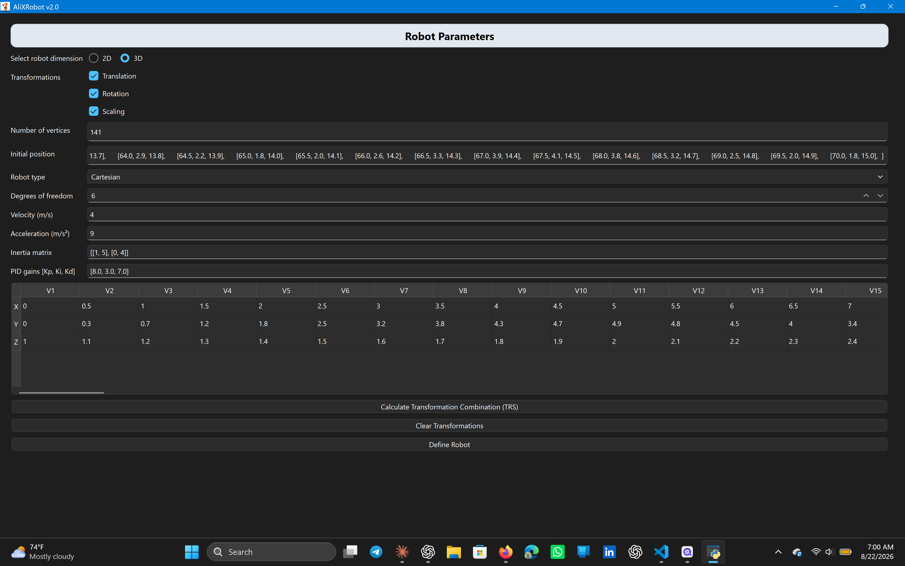
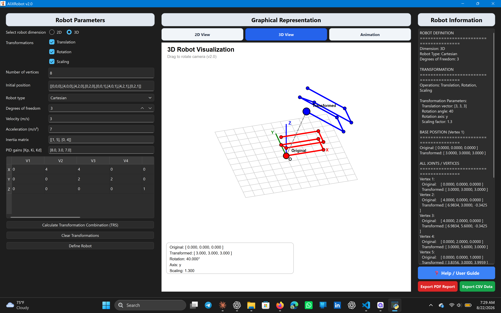
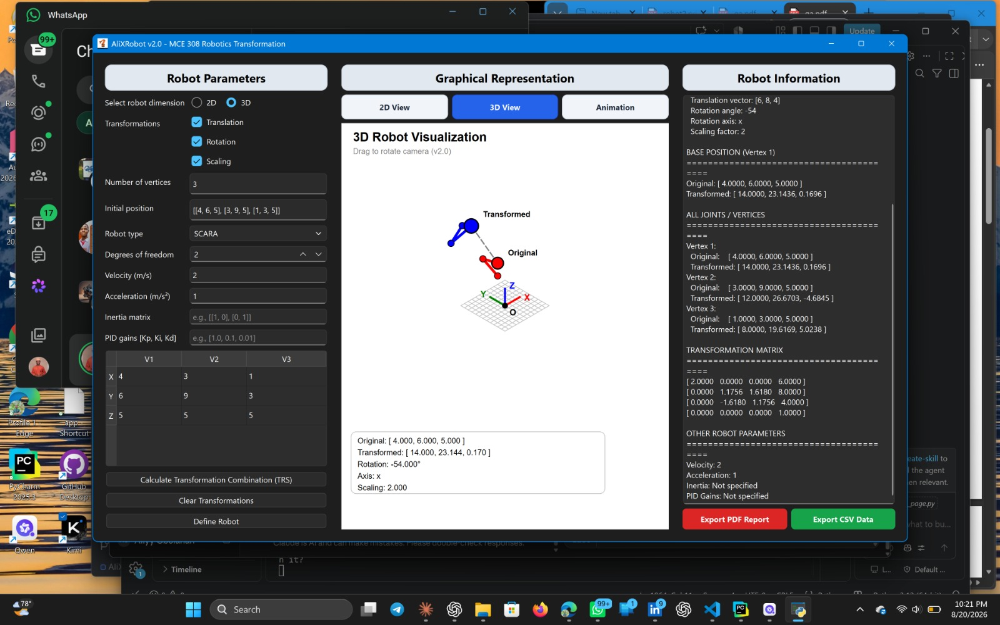
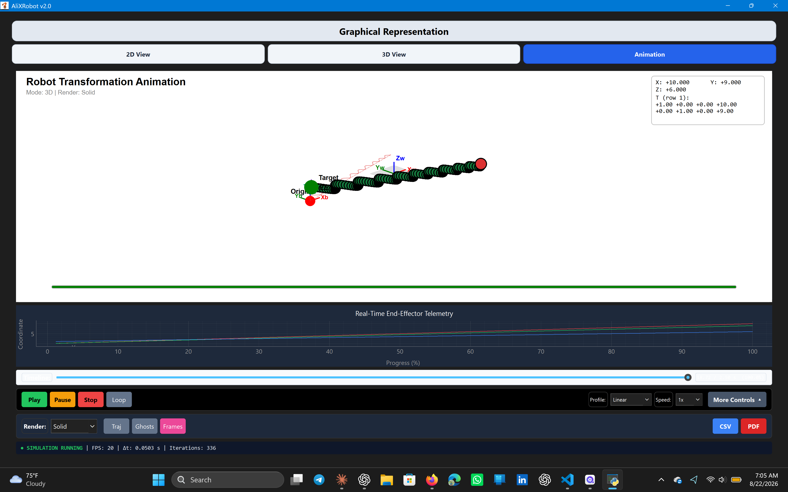
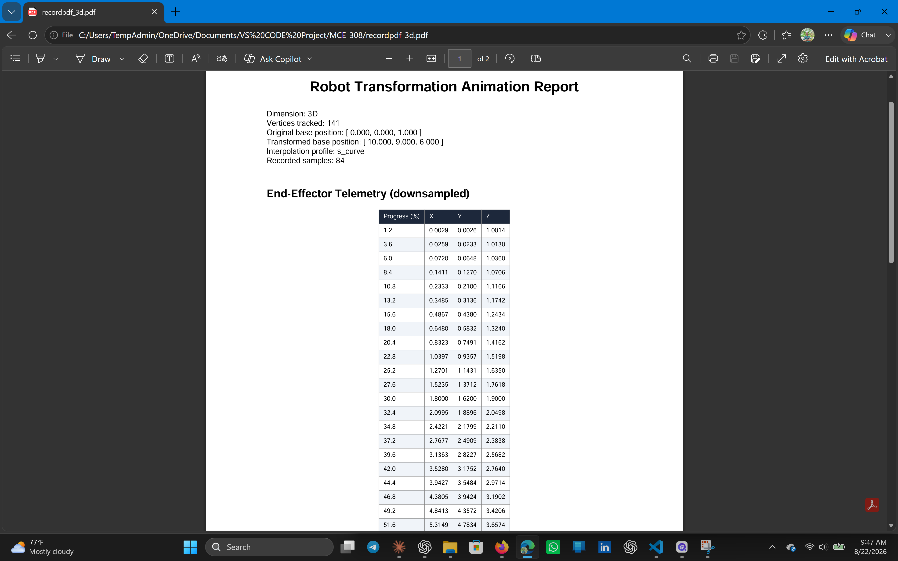
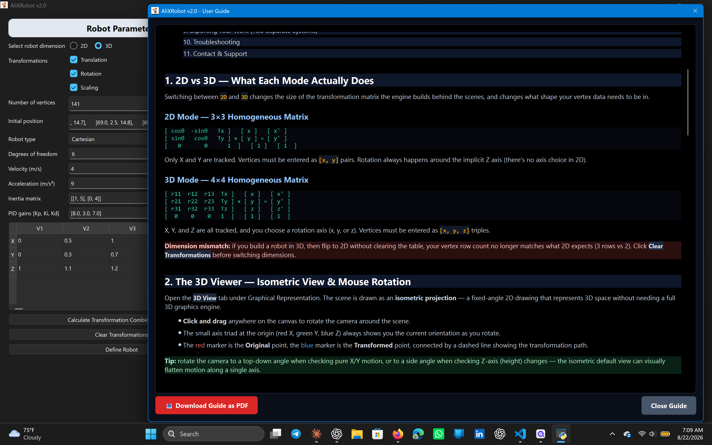
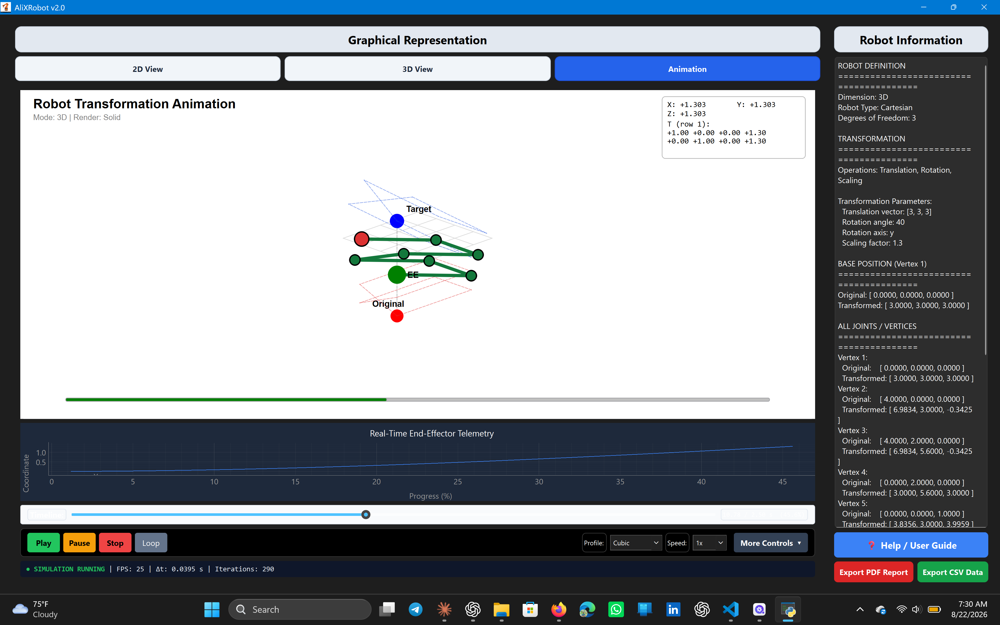

# 🤖 AliXRobot

**A professional desktop software for visualizing 2D/3D robotics kinematics, homogeneous transformations, and trajectory planning — no ROS required.**

Built with PyQt6, PyQtGraph, and pure-Python homogeneous matrix math for robotics research, education, and simulation work.

AliXRobot is a desktop-based robotics visualization and kinematics platform designed to make mathematical transformations and robot motion easier to understand through interactive visualization.



---

## 🎯 Why AliXRobot?

Most robotics software requires Linux, ROS, or complex setups. AliXRobot runs as a **standalone Windows application** that lets you:
- Define robots as vertex sets
- Apply transformations through proper 3×3/4×4 homogeneous matrices
- Watch motion animate in real-time with telemetry
- Export professional PDF reports and CSV data
- **All without installing Python or dependencies**


Developed by Musa Aliyy Gbolahan in the Department of Mechatronics Engineering, Federal University of Technology, Akure (FUTA), as a course project for MCE 308. The platform was developed to support kinematics research and provide a visual approach to teaching robotics concepts.

---

## 📸 Screenshots

### 2D Transformation View
| 2D Plane Mapping |
|---|
|  |

### 3D Isometric Visualization
| 3D View - Graph 1 | 3D View - Graph 2 |
|---|---|
|  |  |

| 3D View - Graph 4 |
|---|
|  |

### Animation Studio with Real-Time Telemetry
| Animation & Graphs |
|---|
|  |

### Technical PDF Report Export
| Generated PDF |
|---|
|  |

### In-App User Guide
| Help Documentation |
|---|
|  |

### Main Interface Overview
| Complete Workspace |
|---|
|  |

---

## 🎬 Demo Videos

### 2D Transformation Animation
[▶ Watch 2D Animation](screenrecord_animation/demo_2d_animation.mp4)

### 3D Visualization Demos

**Wireframe Mode:**  
[▶ Watch 3D Wireframe](screenrecord_animation/demo_3d_wireframe_animation.mp4)

**Solid Mode:**  
[▶ Watch 3D Solid](screenrecord_animation/demo_3d_solid_animation.mp4)

**Transformation Sequence:**  
[▶ Watch Transformation](screenrecord_animation/demo_3d_transformation.mp4)

> **💡 Video Playback Tip:** GitHub doesn't auto-embed videos in README files. To see them play inline:
> 1. Click the video link above (opens in browser)
> 2. Or, drag the `.mp4` file directly into a GitHub issue/PR for inline playback
> 3. For best viewing, download and play locally

---

## ✨ Key Features

###  Core Capabilities
- **Dual Visualization Modes**
  - 2D plane mapping with real-time coordinate tracking
  - 3D isometric projection with auto-scaling
  
- **Advanced Motion Profiles**
  - Linear interpolation (constant velocity)
  - Trapezoidal profile (smooth acceleration/deceleration)
  - Quintic/S-Curve interpolation (smooth position, velocity, and acceleration profiles with controlled jerk)
  - Real-time telemetry graphing (position, velocity, acceleration)
  
- **Professional Export Tools**
  - One-click PDF report generation for lab assignments
  - CSV data export for MATLAB/Excel analysis
  - Motion history visualization ("ghosts")
  - End-effector trajectory path tracking
  - Coordinate frame visualization (World, Base, End-Effector)
  
- **User-Friendly Interface**
  - Standalone Windows executable (no Python installation needed)
  - Intuitive parameter input with validation
  - Interactive in-app user guide with troubleshooting
  - Keyboard shortcuts for power users

###  Educational Value
- Visualizes abstract homogeneous transformation matrices
- Demonstrates effects of translation, rotation, and scaling
- Teaches motion profiles and trajectory planning
- Analyzes robot workspace and kinematics
- Generates professional lab reports automatically

---

## 📥 Installation

### Option 1: Run from Source (Developers)

```bash
# Clone the repository
git clone https://github.com/aliyy2003musa-stack/AliXRobot.git
cd AliXRobot

# Create virtual environment
python -m venv .venv

# Activate environment
# Windows:
.venv\Scripts\activate
# macOS/Linux:
source .venv/bin/activate

# Install dependencies
pip install -r requirements.txt

# Run the application
python main_page.py

### Option 2: Use the Executable (Windows Users)

If you don't want to install Python or set up a development environment:

1. Download the latest release from [Releases](../../releases)
2. Extract the `.zip` file
3. Double-click `AliXRobot_v2.exe`
4. If Windows shows a security warning:
   - Click **"More info"**
   - Click **"Run anyway"**
   - *(This is normal for unsigned applications)*

### 📋 Requirements

- **Python:** 3.10 or higher (for Option 1)
-  ** Developed and tested with:** Python 3.13
- **Dependencies:** (Automatically installed via `requirements.txt`)
  - `PyQt6` (GUI framework)
  - `pyqtgraph` (Real-time graphing)


---

## 📖 Quick Start Guide

### 1. Define Your Robot
- **Select Dimension:** Choose **2D** or **3D** mode
- **Number of Vertices:** Enter joints count (e.g., 2, 3, 5)
- **Input Coordinates:** 
  - Use the table for X, Y (and Z for 3D)
  - Or paste in text box:
    - **2D:** `[[0, 0], [1, 0], [1, 1]]`
    - **3D:** `[[0, 0, 0], [1, 0, 0], [1, 1, 0]]`

### 2. Apply Transformations
- Check transformations to apply:
  - ☑️ **Translation** - Move in space
  - ️ **Rotation** - Rotate around axis
  - ☑️ **Scaling** - Resize structure
- Click **"Calculate TRS"** to enter values
- Click **"Define Robot"** to visualize

### 3. Visualize & Animate
- **2D View:** See transformation on X-Y plane
- **3D View:** View isometric projection
- **Animation Tab:**
  - Select motion profile (Linear/Trapezoidal/S-Curve)
  - Adjust speed (0.25x to 4x)
  - Click **Play** to watch
  - Use timeline slider to scrub frames

### 4. Export Results
- **PDF Report:** Formatted document with calculations
- **CSV Data:** Raw numerical data for analysis

---

## 🏗️ Project Structure

AliXRobot/
├── main_page.py # Main application
├── robotEngine.py # Core kinematics engine
├── robotControl_logic.py # Transformation logic
├── coordinate_system.py # Coordinate handling
├── _user_guide_content.py # HTML documentation
├── test_engine.py # Unit tests
├── requirements.txt # Dependencies
├── README.md # This file
├── robot_icon.ico # Application icon
│
├── screenshot/ # Documentation images
│ └── (your screenshots)
│
├── screenrecord_animation/ # Demo videos
│ └── (your videos)
│
└── visualization/
├── __init__.py
├── view_2d.py # 2D visualization
├── view_3d.py # 3D visualization
├── animation.py # Animation engine
└── geometry.py # Workspace utilities


---

## 🛠️ Tech Stack

- **Language:** Python 3.13
- **GUI Framework:** PyQt6
- **Graphing:** PyQtGraph (real-time telemetry)
- **PDF Generation:** PyQt6 `QPrinter` & `QTextDocument` (Native HTML-to-PDF)
- **Data Export:** Python built-in `csv` module
- **Packaging:** PyInstaller
- **Mathematics:** Custom homogeneous transformation engine
---

## 🔬 Technical Details

### Homogeneous Transformation Matrices
**2D Mode (3×3 Matrix):**
[ cos(θ) -sin(θ) Tx ]
[ sin(θ) cos(θ) Ty ]
[ 0 0 1 ]

**3D Mode (4×4 Matrix):**
[ r11 r12 r13 Tx ]
[ r21 r22 r23 Ty ]
[ r31 r32 r33 Tz ]
[ 0 0 0 1 ]


### Motion Profiles

1. **Linear:** Constant velocity, infinite acceleration at boundaries
2. **Trapezoidal:** Smooth acceleration/deceleration phases
3. **Quintic / S-Curve: Provides smooth, continuous position, velocity, and acceleration profiles with bounded/controlled jerk, preventing mechanical stress in industrial applications

---

## 🐛 Troubleshooting

### Common Issues

**"Windows protected your PC" warning:**
- ✅ Normal for unsigned applications
- Click "More info" → "Run anyway"

**Robot disappears from view:**
- Check if scaling factor is 0
- Click "Reset View" button
- Verify translation values aren't too large

**Animation is jerky:**
- Switch from "Linear" to "Trapezoidal" or "S-Curve"
- Linear has infinite acceleration at start/stop

**Dimension mismatch error:**
- Use 2D coordinates `[[x,y]]` in 2D mode
- Use 3D coordinates `[[x,y,z]]` in 3D mode

**TRS button does nothing:**
- Check at least one transformation box first

---

## 🚀 Roadmap

**Planned Features:**
- [ ] Inverse kinematics solver
- [ ] Denavit-Hartenberg parameter input
- [ ] Multi-robot simulation
- [ ] Collision detection
- [ ] ROS integration
- [ ] Dynamic simulation (forces, torques)

---

## 🤝 Contributing

Contributions are welcome!

1. **Fork** the repository
2. **Create** a feature branch (`git checkout -b feature/AmazingFeature`)
3. **Commit** your changes (`git commit -m 'Add some AmazingFeature'`)
4. **Push** to the branch (`git push origin feature/AmazingFeature`)
5. **Open** a Pull Request

---

## 📊 Project Statistics

- **Lines of Code:** ~2,000+
- **Development Time:** 3 months
- **Version:** 2.0
- **Last Updated:** August 2026
- **Python Version:** 3.13
- **Supported OS:** Windows 10/11

---

## 📧 Contact

**Developer:** Musa Aliyy Gbolahan  
**Email-1:** aliyy23musa@gmail.com  
**Email-2:** aliyy23musa@gmail.com
**GitHub:** [@aliyy2003musa-stack](https://github.com/aliyy2003musa-stack)  
**LinkedIn:** [Musa Aliyy Gbolahan](https://www.linkedin.com/in/aliyy-gbolahan)  

For bug reports, feature requests, or collaboration.

---

## 📄 License

MIT LICENSE

##  Acknowledgments

- **MCE 308 Robotics Course** - Federal University of Technology, Akure (FUTA)
- **PyQt6 Community** - Excellent GUI framework
- **PyQtGraph** - High-performance real-time graphing
- **Open-source robotics community** - Inspiration and reference

---

<div align="center">

**Made with ❤️ for the robotics community**

⭐ **Star this repo if you found it helpful!**

[Report Bug](../../issues) · [Request Feature](../../issues) · [Download Release](../../releases)

**Version 2.0 | Last Updated: August 2026**

</div>
